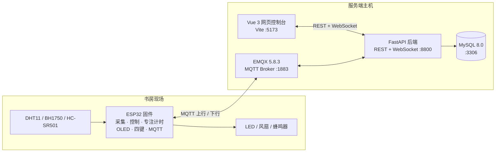

# StudySense 智能书房环境调节系统

基于 ESP32 与自建物联网平台的智能书房毕业设计：采集书房温湿度、光照与人体状态，自动调节灯光和风扇，并通过网页控制台实现远程监控、历史分析、自动化规则、操作审计与专注学习管理。

系统完全自建，不依赖第三方物联网云服务，可在本地局域网内独立运行。

## 项目组成

| 子项目 | 目录 | 说明 |
| --- | --- | --- |
| ESP32 固件端 | [`StudySense/`](StudySense/) | 传感器采集、执行器控制、OLED 交互、专注计时、MQTT 通信 |
| 服务端与网页控制台 | [`StudySense-Server/`](StudySense-Server/) | FastAPI 后端 + Vue 3 网页 + MySQL + EMQX |

## 功能特性

- **环境感知**：DHT11 温湿度、BH1750 光照、HC-SR501 人体感应；人体检测带 120 秒保持窗口，避免人静止时灯光反复开关。
- **自动调节**：自动模式下按温度上限控制风扇，按光照下限与人体状态控制灯光，阈值可在设备菜单或网页修改。
- **本地闭环优先**：网络或服务端不可用时，ESP32 仍可本地采集、显示、按键控制与自动调节。
- **专注学习模式**：设备端长按 K4 进入专注，OLED 计时与休息提醒可调；网页与设备共享同一计时、暂停与结束状态，专注会话永久保存并生成学习报告。
- **网页控制台**：实时仪表盘、控制中心、历史数据、学习报告、设备总览、自动化规则、操作审计七个页面。
- **实时双通道**：REST 接口负责查询与命令，WebSocket 负责状态推送；断线自动重连。
- **自动化规则**：按温度 / 湿度 / 光照 / 人体条件触发 LED、风扇或模式切换，支持边沿触发与冷却时间。
- **可靠通信**：MQTT QoS 1、遗嘱消息（LWT）判定离线、retain 阈值消息，设备重启后自动恢复最新配置。
- **操作可追溯**：云端指令写入审计记录，设备 ack 回执后自动闭环为成功或失败。

## 系统架构



链路说明：

- ESP32 通过 MQTT TCP `1883` 连接 EMQX，上报状态、阈值与指令回执，订阅控制指令与阈值下发。
- FastAPI 使用 `aiomqtt` 订阅 `studysense/+/...`，收到消息后更新内存快照、写库并广播 WebSocket。
- 网页通过 Vite 代理（开发）或 Nginx 反向代理（生产）访问 `/api` 与 `/ws`。
- 设备状态是最终权威：云端只负责下发、缓存与展示，避免"界面已操作、设备未执行"的假同步。

## 目录结构

```
auto_server/
├── README.md                        # 本文件
├── 架构设计.md                       # 总体架构、模块设计与接口契约
├── StudySense/                      # ESP32 固件端（PlatformIO）
│   ├── platformio.ini
│   ├── README.md
│   └── src/
│       ├── main.cpp                 # 主流程与按键分发
│       ├── config.example.h         # 配置模板（复制为 config.h 后修改）
│       ├── sensors.*                # DHT11 / BH1750 / PIR
│       ├── control.*                # 执行器、自动控制、专注计时
│       ├── display.*                # OLED 界面与弹框
│       ├── keys.*                   # 按键扫描、消抖、长按
│       ├── wifi_conn.*              # WiFi 连接
│       └── mqtt_conn.*              # MQTT 上报与指令处理
└── StudySense-Server/               # 服务端 + 网页控制台
    ├── docker-compose.yml           # MySQL 8.0 + EMQX 5.8.3
    ├── start.bat                    # Windows 一键启动
    ├── ESP32固件对接规范.md          # MQTT 主题与 JSON 契约
    ├── README.md
    ├── backend/                     # FastAPI + SQLAlchemy 异步
    │   ├── requirements.txt
    │   ├── run.py                   # 启动入口（Windows SelectorEventLoop）
    │   ├── sim_device.py            # 无硬件联调模拟器
    │   └── app/
    │       ├── main.py              # 路由注册、WebSocket、启动初始化
    │       ├── mqtt_service.py      # MQTT 订阅与下发
    │       ├── realtime.py          # 实时状态、广播、离线检测、数据清理
    │       ├── focus_service.py     # 专注会话状态机
    │       ├── rule_engine.py       # 自动化规则
    │       ├── audit_service.py     # 指令审计与 ack 闭环
    │       └── routers/             # auth / data / control / threshold / study / devices / audit / rules
    └── frontend/                    # Vue 3 + Vite + Element Plus + ECharts
        ├── package.json
        ├── vite.config.js
        └── src/
            ├── api.js               # Axios、JWT 注入
            ├── ws.js                # WebSocket 单例与重连
            ├── focus.js             # 专注计时插值与弹框状态
            ├── layout/AppLayout.vue
            └── views/               # Login / Dashboard / Control / History / Study / Devices / Rules
```

## 硬件清单

| 模块 | 型号 / 说明 | 接线（ESP32 引脚） |
| --- | --- | --- |
| 主控 | ESP32 DevKit | — |
| 温湿度传感器 | DHT11 | DATA = GPIO4 |
| 光照传感器 | BH1750（I2C 地址 0x23） | SDA = GPIO21，SCL = GPIO22 |
| 人体红外 | HC-SR501 | OUT = GPIO13 |
| OLED 显示屏 | 0.96" SSD1306 128×64（I2C 地址 0x3C） | I2C（与 BH1750 共用） |
| LED 照明 | 3W LED 模块，高电平点亮 | GPIO14 |
| 风扇 | L9110S 驱动 + 直流风扇，PWM 三档调速 | IN1 = GPIO18，IN2 = GPIO19 |
| 蜂鸣器 | 有源蜂鸣器，高电平触发 | GPIO27 |
| 按键 | 4 键模块，低电平按下 | GPIO25 / 26 / 32 / 33 |

> 风扇建议使用独立 5V 电源并与 ESP32 共地；详细接线与按键说明见 [`StudySense/README.md`](StudySense/README.md)。

## 技术栈

| 层级 | 技术 |
| --- | --- |
| 固件 | ESP32、Arduino C++、PlatformIO、PubSubClient、U8g2、DHT、BH1750 |
| 消息接入 | EMQX 5.8.3、MQTT（QoS 1 / LWT / retain） |
| 后端 | FastAPI、Uvicorn、Pydantic v2、SQLAlchemy 2（异步）、aiomysql、aiomqtt |
| 鉴权 | JWT（PyJWT）、PBKDF2-SHA256 |
| 数据库 | MySQL 8.0 |
| 前端 | Vue 3、Vite、Vue Router、Element Plus、ECharts、Axios |
| 部署 | Docker Compose、Windows 一键脚本 |

## 快速开始

### 环境要求

- **Docker Desktop**（运行 MySQL 与 EMQX）
- **Python 3.11**（推荐；用于后端）
- **Node.js 18+**（建议 18 / 20 LTS）
- **VS Code + PlatformIO IDE**（仅烧录固件时需要）

### 1. 启动依赖服务

```bash
cd StudySense-Server
docker compose up -d
docker compose ps
```

| 服务 | 地址 | 说明 |
| --- | --- | --- |
| MySQL | `127.0.0.1:3306` | 库名 `studysense` |
| EMQX MQTT | `127.0.0.1:1883` | ESP32 与后端连接 |
| EMQX 管理界面 | http://localhost:18083 | 默认账号 `admin` / `public` |

### 2. 启动后端

```bat
cd StudySense-Server\backend
python -m venv .venv
.venv\Scripts\activate
pip install -r requirements.txt
python run.py
```

- 后端监听 `0.0.0.0:8800`，接口文档：http://localhost:8800/docs
- **Windows 上必须使用 `run.py` 启动**：它会设置 `SelectorEventLoopPolicy`，否则 aiomqtt 无法正常工作
- 首次启动自动建表，并创建管理员账号与默认设备
- 后端配置从 `backend/.env` 读取；未创建时使用与 `docker-compose.yml` 一致的内置默认值，可按需创建：

```ini
# StudySense-Server/backend/.env（示例）
ADMIN_USERNAME=admin
ADMIN_PASSWORD=admin123
JWT_SECRET=please-change-me
DEVICE_ID=esp32_01
```

### 3. 启动网页控制台

```bash
cd StudySense-Server/frontend
npm install
npm run dev
```

浏览器打开 http://localhost:5173，使用默认账号 `admin` / `admin123` 登录。

> 首次完成依赖安装后，可直接双击 `StudySense-Server/start.bat` 一键拉起容器、后端与前端。

### 4. 接入 ESP32（或使用模拟器）

**有硬件**：复制配置模板并填写本地 WiFi 与电脑局域网 IP，然后烧录：

```bash
cd StudySense
copy src\config.example.h src\config.h    # macOS / Linux: cp src/config.example.h src/config.h
pio run -t upload
```

```c
// StudySense/src/config.h
#define WIFI_SSID     "你的WiFi名称"
#define WIFI_PASSWORD "你的WiFi密码"
#define MQTT_HOST     "192.168.1.100"   // 运行服务端电脑的局域网 IPv4
#define MQTT_CLIENT_ID "esp32_01"        // 与服务端 DEVICE_ID 一致
```

**无硬件**：另开终端运行模拟器，每 2 秒上报一次并响应云端指令：

```bat
cd StudySense-Server\backend
.venv\Scripts\python.exe sim_device.py
```

推荐启动顺序：依赖服务 → 后端 → 网页 → 设备上电。设备上线后，网页右上角显示"设备在线"，仪表盘出现实时数据即接通。

## 默认端口与账号

| 服务 | 地址 | 默认凭证 |
| --- | --- | --- |
| 网页控制台 | http://localhost:5173 | `admin` / `admin123` |
| 后端 API / WebSocket | http://localhost:8800 | JWT 鉴权，见 `/docs` |
| EMQX 管理界面 | http://localhost:18083 | `admin` / `public` |
| MySQL | 127.0.0.1:3306 | `studysense` / `studysense123` |

> 管理员账号仅在首次建库时创建，之后修改 `ADMIN_PASSWORD` 不会覆盖已有账号。

## MQTT 主题一览

| 方向 | Topic | QoS | Retain | 用途 |
| --- | --- | --- | --- | --- |
| 设备 → 云 | `studysense/esp32_01/state/up` | 1 | 否 | 每 10 秒上报传感器与设备状态 |
| 设备 → 云 | `studysense/esp32_01/threshold/up` | 1 | 否 | 设备端修改阈值后上报 |
| 设备 → 云 | `studysense/esp32_01/cmd/ack` | 1 | 否 | 指令执行回执 |
| 设备 → 云 | `studysense/esp32_01/status` | 1 | 是 | 在线状态（上线 `online`，遗嘱 `offline`） |
| 云 → 设备 | `studysense/esp32_01/cmd/down` | 1 | 否 | LED / 风扇 / 模式 / 专注交互指令 |
| 云 → 设备 | `studysense/esp32_01/threshold/down` | 1 | 是 | 阈值下发（保留消息） |

完整 JSON 字段与控制指令见 [`ESP32固件对接规范.md`](StudySense-Server/ESP32固件对接规范.md)。

## 配置与安全

本仓库不提交任何真实密钥：

- 固件：`StudySense/src/config.h` 已被忽略，仓库仅保留模板 `config.example.h`；其中包含 WiFi 密码与电脑 IP。
- 后端：`StudySense-Server/backend/.env` 已被忽略，其中包含数据库密码、管理员密码与 JWT 密钥。

当前配置面向本地局域网演示。公网部署前建议至少完成：

1. 修改 `JWT_SECRET`、MySQL 密码与管理员密码。
2. 为 EMQX 开启用户名密码认证与 ACL，关闭匿名接入，并同步更新固件凭证。
3. 使用 Nginx / Caddy 提供 HTTPS 与 WSS，收紧 CORS 允许来源。
4. 不要把 3306、1883、18083 直接暴露到公网。
5. 定期备份 MySQL 数据卷；审计与专注会话为永久数据。

## 已知限制

- 实时链路以单主设备 `DEVICE_ID` 为中心（主题与 `device` 表已为多设备预留）。
- 阈值为全局单行配置，未按设备隔离。
- 单管理员模型，无角色与用户管理。
- 审计等待队列在内存中，后端重启后未闭环记录会停留在 `pending`。
- 未引入 Alembic，表结构变更依赖 `create_all` 与手工轻量迁移。
- 规则引擎仅支持单条件 `>` / `<`，不支持复合条件与时间窗口。

## 文档导航

| 文档 | 内容 |
| --- | --- |
| [`架构设计.md`](架构设计.md) | 总体架构、模块设计、端到端流程、接口契约与设计取舍 |
| [`StudySense/README.md`](StudySense/README.md) | 固件功能、硬件接线、按键交互、烧录与排障 |
| [`StudySense-Server/README.md`](StudySense-Server/README.md) | 服务端与网页功能、REST API、数据库、部署与排障 |
| [`StudySense-Server/ESP32固件对接规范.md`](StudySense-Server/ESP32固件对接规范.md) | MQTT 主题、JSON 字段与指令回执契约 |

后端启动后，可访问 http://localhost:8800/docs 查看自动生成的 OpenAPI 接口文档。
