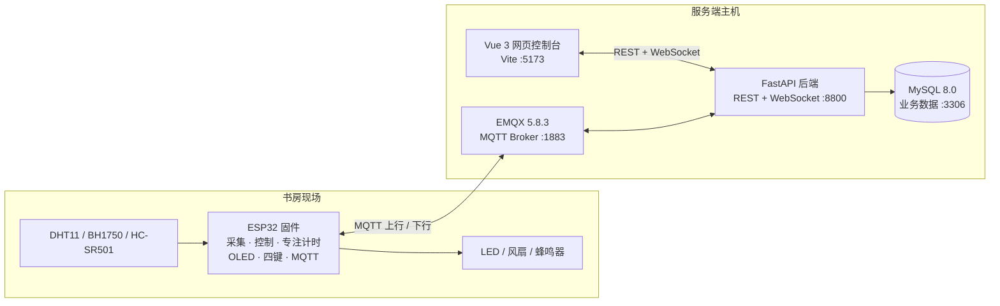
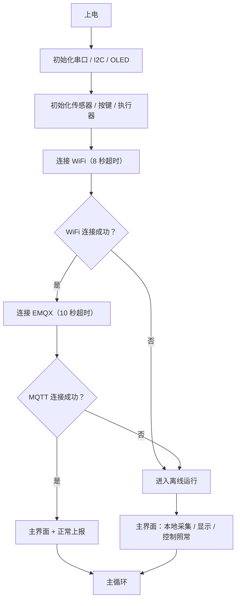
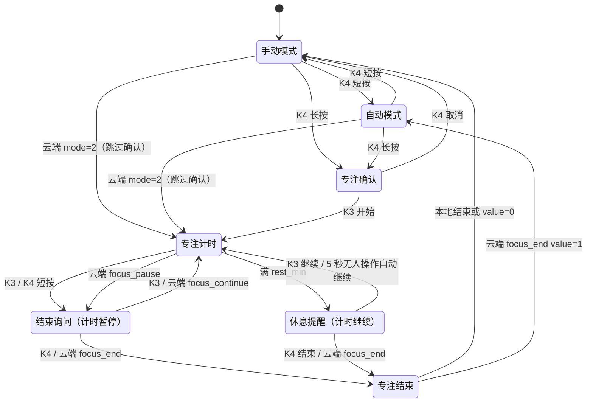
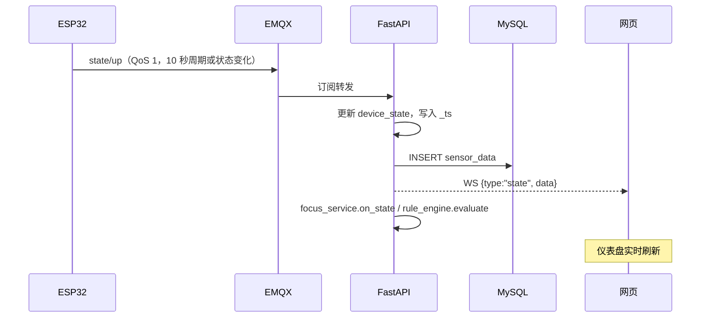
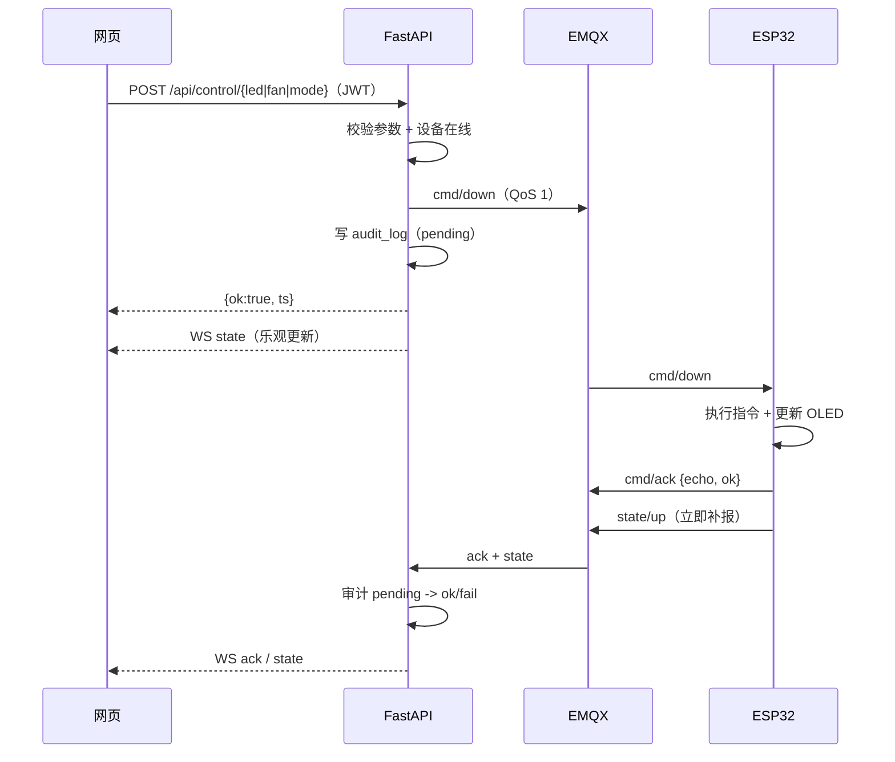
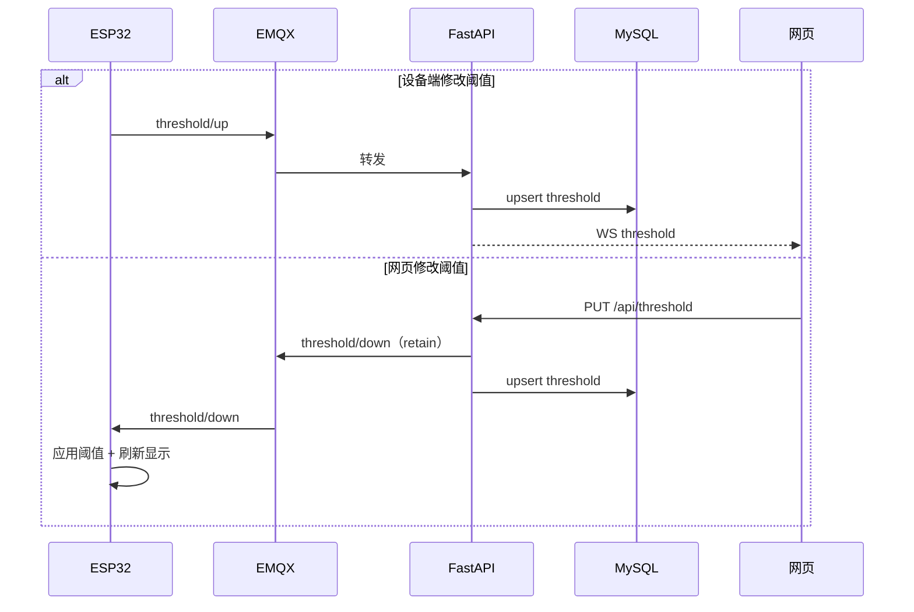
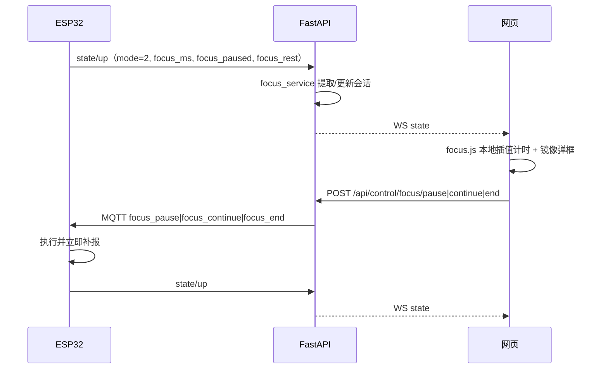
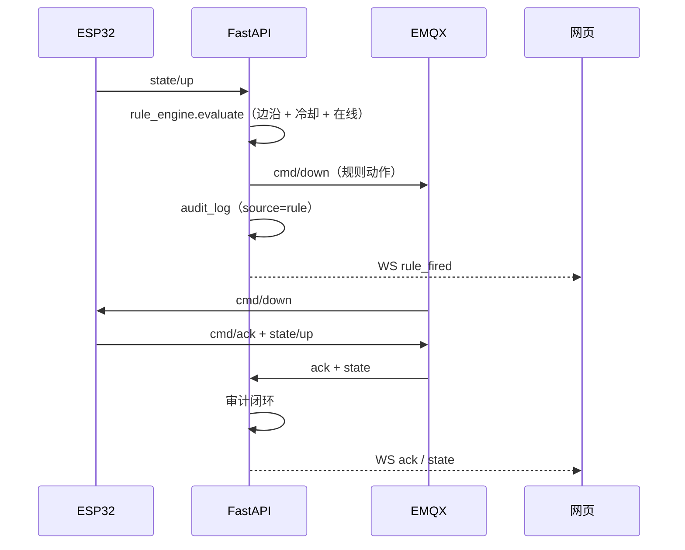
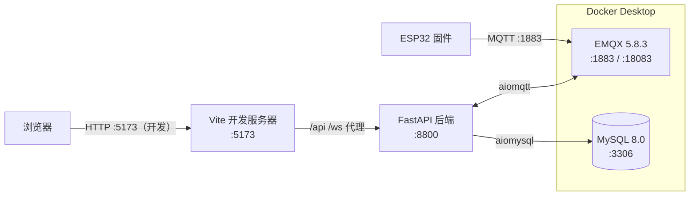

# StudySense 智能书房系统架构设计

> 文档版本：v1.0  
> 更新日期：2026-11-19  
> 文档范围：`StudySense/`（ESP32 固件端）与 `StudySense-Server/`（服务端 + Vue 网页控制台）  
> 说明：项目曾包含独立移动端，现已从仓库移除。本文档只描述当前保留的两个子项目；服务端 REST / WebSocket 仍保持通用，网页控制台是当前唯一前端。

---

## 1. 项目概述

### 1.1 背景与目标

StudySense 是一套面向书房场景的智能环境调节与专注学习管理系统。系统以 ESP32 为现场主控，采集温度、湿度、光照与人体状态，控制 LED 照明、风扇和蜂鸣器，并通过自建 MQTT + FastAPI 平台实现远程监控、历史数据、自动化规则与学习报告。

系统要解决的核心问题：

- **环境舒适度**：根据温度与光照自动调节风扇和灯光，减少手动操作。
- **远程可观测**：在网页控制台查看实时数据、在线状态、历史曲线与统计。
- **专注学习管理**：设备端和网页端共享同一个专注计时与休息提醒状态，学习记录可长期保存。
- **行为可追溯**：所有云端指令都有审计记录，设备回执后自动闭环为成功或失败。
- **离线可用**：网络或服务端不可用时，ESP32 仍能本地采集、显示、按键控制与自动调节。

### 1.2 子项目划分

| 子项目 | 目录 | 角色 | 主要技术 |
| --- | --- | --- | --- |
| 固件端 | `StudySense/` | 现场采集、执行器控制、OLED 交互、专注计时、MQTT 通信 | ESP32、Arduino C++、PlatformIO、PubSubClient、U8g2 |
| 服务端 | `StudySense-Server/` | MQTT 接入、REST API、WebSocket、数据持久化、规则与审计、网页控制台 | FastAPI、SQLAlchemy 2、MySQL 8、EMQX、Vue 3、Vite |

### 1.3 核心设计原则

1. **本地闭环优先**：环境自动控制与专注计时在 ESP32 本地完成，云端断连不影响书房基本功能。
2. **设备状态为权威**：LED、风扇、模式、专注时长的最终真相来自设备上报；云端只做下发、缓存和展示。
3. **事件驱动 + 周期兜底**：状态变化立即上报，同时每 10 秒周期上报一次，兼顾实时性与可靠性。
4. **双通道同步**：网页通过 REST 做查询与命令，通过 WebSocket 接收实时推送；WebSocket 断线自动重连。
5. **轻量接入**：设备侧使用 MQTT QoS 1、遗嘱消息（LWT）和 retain 消息，适配资源受限的 ESP32。
6. **单管理员、最小权限**：当前面向本地演示，管理接口统一 JWT 鉴权，不引入复杂角色体系。

---

## 2. 总体架构

### 2.1 逻辑架构图



链路说明：

- **设备到 Broker**：ESP32 通过 MQTT TCP `1883` 连接 EMQX，上报状态、阈值与指令回执，订阅控制指令与阈值下发。
- **Broker 到服务端**：FastAPI 使用 `aiomqtt` 订阅 `studysense/+/...` 主题，收到消息后更新内存状态、写库、广播 WebSocket。
- **服务端到数据库**：SQLAlchemy 2 异步引擎 + `aiomysql` 访问 MySQL 8。
- **网页到服务端**：开发环境由 Vite 代理 `/api` 与 `/ws` 到 `127.0.0.1:8800`；生产环境建议用 Nginx 做同源反向代理。
- **服务端到设备**：控制指令发布到 `studysense/{DEVICE_ID}/cmd/down`，阈值通过 retain 消息发布到 `threshold/down`。

### 2.2 分层视图

| 层级 | 组成 | 职责 |
| --- | --- | --- |
| 感知层 | DHT11、BH1750、HC-SR501 | 温湿度、光照、人体存在检测 |
| 执行层 | 3W LED、L9110S + 风扇、有源蜂鸣器 | 照明、三档风速、声音提示 |
| 人机交互层 | SSD1306 OLED、四键键盘 | 本地显示、菜单设置、专注弹框交互 |
| 设备控制层 | ESP32 固件 | 采样调度、自动控制、模式管理、专注计时、离线运行 |
| 接入层 | EMQX | MQTT 连接、主题路由、遗嘱消息、保留消息 |
| 服务层 | FastAPI | 鉴权、REST、WebSocket、状态中心、规则引擎、审计、专注会话提取 |
| 数据层 | MySQL + 后端内存状态 | 历史与业务数据持久化、实时快照缓存 |
| 展示层 | Vue 3 网页控制台 | 仪表盘、控制中心、历史、学习报告、设备、规则 |

### 2.3 技术选型

| 类别 | 技术 | 选型理由 |
| --- | --- | --- |
| 主控 | ESP32 DevKit | 内置 WiFi、GPIO 丰富、支持 Arduino 生态 |
| 固件框架 | Arduino C++ + PlatformIO | 库生态成熟，便于传感器与 OLED 驱动 |
| 设备通信 | MQTT（PubSubClient） | 轻量、发布订阅、支持 QoS / LWT / retain |
| 消息 Broker | EMQX 5.8.3 | 独立部署、管理界面完善、支持遗嘱与保留消息 |
| 后端框架 | FastAPI + Uvicorn | 异步原生、自动生成 OpenAPI 文档、开发效率高 |
| 数据访问 | SQLAlchemy 2（异步）+ aiomysql | 异步连接池、模型清晰、适合中小型服务 |
| 数据库 | MySQL 8.0 | 成熟稳定、JSON 字段支持阈值配置 |
| MQTT 客户端 | aiomqtt | 与 asyncio 事件循环集成，自动重连逻辑可控 |
| 鉴权 | PyJWT + PBKDF2-SHA256 | 无额外依赖、实现简单、适合单管理员场景 |
| 前端 | Vue 3 + Vite + Element Plus + ECharts | 组件化、开发热更新、图表能力完善 |
| 部署 | Docker Compose + Windows 启动脚本 | MySQL / EMQX 一键拉起，降低演示环境门槛 |

---

## 3. 项目一：ESP32 固件端（StudySense）

### 3.1 职责与边界

固件端负责书房现场的实时闭环：

- 每 2 秒读取 DHT11、BH1750、HC-SR501。
- 在自动模式下根据温湿度/光照/人体状态控制 LED 与风扇。
- 在本地 OLED 上显示环境数据、工作模式、专注计时和设置菜单。
- 扫描四键键盘，处理模式切换、阈值调整、专注开始/继续/结束。
- 每 10 秒通过 MQTT 上报一次状态；按键、云端指令、弹框状态变化后立即补报。
- 接收云端控制指令、阈值下发，执行后回复 ack。
- WiFi / MQTT 断开时继续本地运行，恢复后自动重连。

固件**不负责**历史存储、用户登录、跨设备统计和网页渲染；这些由服务端完成。

### 3.2 硬件组成

| 模块 | 型号 / 说明 | 接线（ESP32 引脚） |
| --- | --- | --- |
| 主控 | ESP32 DevKit | — |
| 温湿度传感器 | DHT11 | DATA = GPIO4 |
| 光照传感器 | BH1750（I2C 地址 0x23） | SDA = GPIO21，SCL = GPIO22 |
| 人体红外 | HC-SR501 | OUT = GPIO13 |
| OLED 显示屏 | 0.96" SSD1306 128×64（I2C 地址 0x3C） | 与 BH1750 共用 I2C |
| LED 灯珠 | 3W LED 模块 | 信号 = GPIO14（高电平亮） |
| 风扇驱动 | L9110S | A/IN1 = GPIO18，B/IN2 = GPIO19 |
| 有源蜂鸣器 | 高电平触发 | GPIO27 |
| 独立键盘 | 4 键模块（低电平按下，内部上拉） | K1 = GPIO26，K2 = GPIO25，K3 = GPIO33，K4 = GPIO32 |

> 风扇建议使用独立 5V 电源并与 ESP32 共地；L9110S 的 A/B 两路输入分别接 GPIO18 / GPIO19，固件通过两路 PWM 控制正转与占空比。

### 3.3 软件模块

| 文件 | 职责 |
| --- | --- |
| `src/main.cpp` | 初始化、开机动画、按键分发、主循环调度、专注弹框与休息提醒流程 |
| `src/config.h` | 引脚、WiFi、MQTT、采样/上报周期、按键时序、阈值范围等全部常量 |
| `src/sensors.*` | DHT11、BH1750、PIR 采集与数据有效性处理 |
| `src/control.*` | 执行器状态、自动控制、工作模式、专注计时、蜂鸣器状态机 |
| `src/display.*` | OLED 开机动画、主界面、设置菜单、专注界面、弹框绘制 |
| `src/keys.*` | 四键扫描、消抖、短按/长按/重复触发 |
| `src/wifi_conn.*` | WiFi 连接与状态管理 |
| `src/mqtt_conn.*` | MQTT 连接、遗嘱消息、状态/阈值上报、指令与阈值下发处理 |

### 3.4 启动流程与主循环



主循环的关键节奏：

1. 调用 `mqttLoop()` 维持连接、处理下行消息。
2. 专注模式下按秒边界刷新 OLED 计时，避免整帧重复刷新导致闪烁。
3. 检查休息提醒是否到期；到期先定格显示整分钟，再弹出休息提醒。
4. 扫描按键；仅在阈值调整页面启用长按连续调整。
5. 每 2 秒读取传感器、执行自动控制、刷新 OLED。
6. 每 10 秒上报一次属性；状态变化时立即上报并重置周期计时。
7. 将 LED / 风扇状态应用到硬件，驱动蜂鸣器状态机，`delay(20)` 进入下一轮。

### 3.5 工作模式与自动控制

固件内部有三种工作模式：手动、自动、专注。设备上报和云端下发使用统一数值：

| 数值 | 模式 | 行为 |
| --- | --- | --- |
| `0` | 手动 | 按键或云端直接控制执行器；进入手动模式时关闭灯光与风扇 |
| `1` | 自动 | 按温度 / 光照 / 人体条件自动控制；手动或云端操作过的执行器暂时不再被自动覆盖 |
| `2` | 专注 | 开始学习计时；灯光与风扇保持当前状态，不打断学习环境 |

> 注意：固件内部 `WorkMode` 枚举的声明顺序与 MQTT 数值不同（内部 `MODE_AUTO=0`、`MODE_MANUAL=1`），转换在 `mqtt_conn.cpp` 上报/下发时完成。对接协议时以 `0=手动 / 1=自动 / 2=专注` 为准。

自动控制规则：

| 场景 | 行为 |
| --- | --- |
| 自动模式，温度 ≥ 温度上限 | 打开风扇一档（若风扇未被手动/云端接管） |
| 自动模式，温度 < 温度上限 | 关闭风扇（同上） |
| 自动模式，有人且光照 ≤ 光照下限 | 打开 LED（若 LED 未被手动/云端接管） |
| 自动模式，无人或光照 > 光照下限 | 关闭 LED（同上） |
| 按键 / 云端操作过风扇或灯光 | 对应执行器标记为“手动优先”，自动控制不再覆盖 |
| 切换工作模式 | 恢复自动接管权；切到手动模式时关闭灯光与风扇 |

人体存在保持：PIR 检测到人后，即使人静止导致 PIR 输出变低，只要在 **120 秒**保持窗口内仍视为“有人”，避免灯光频繁开关。

默认阈值：

- 温度上限：`28.0 °C`
- 光照下限：`300 lx`
- 专注休息提醒间隔：`1` 分钟（可调 1~120 分钟）

网页端阈值滑块范围：温度 `20~35 °C`（步进 0.5）、光照 `0~1000 lx`（步进 10）、休息间隔 `1~120` 分钟。固件本地菜单的范围更宽：温度 `10~40 °C`、光照 `0~2000 lx`。

### 3.6 专注模式设计

专注模式是设备端与网页端联动最紧密的部分。计时、暂停、休息提醒都由 ESP32 本地状态机驱动，云端只负责镜像显示和远程操作。



关键行为：

- **开始**：主界面 K4 长按弹出“是否开始专注”弹框，K3 确认开始，K4 取消回手动；云端下发 `mode=2` 时跳过弹框直接开始计时。
- **计时**：以 `millis()` 为基准维护 `focusStartMs`；暂停时记录 `focusPauseStartMs`，恢复时把计时起点和下次提醒点整体后移暂停时长。
- **结束**：`focusStop()` 冻结本次总时长；本地 K4 结束后回到手动模式，云端 `focus_end` 可按 `value` 回到手动（0）或自动（1）。
- **休息提醒**：每满 `rest_min` 分钟先定格显示整分钟约 1 秒，再弹出休息提醒；提醒期间计时继续，约 5 秒无人操作自动继续。
- **提示音**：进入专注、结束专注、休息提醒均有约 1 秒一声、共五声的蜂鸣提示；状态机在 `loop()` 中非阻塞驱动。
- **上报字段**：`focus`（秒）、`focus_ms`（毫秒）、`focus_paused`（结束询问弹框打开）、`focus_rest`（休息提醒弹框打开）。网页用这些字段做本地插值和弹框镜像，避免两端计时不一致。

### 3.7 本地人机交互

OLED 页面：

- 开机动画：展示“读取传感器 → 初始化按键 → 启动 WiFi → 云平台对接中”的进度。
- 主界面：温度、湿度、光照、人体 / LED / 风扇状态，标题栏显示工作模式。
- 系统设置：温度阈值、光照阈值、休息提醒间隔三页菜单。
- 专注界面：大号计时与操作提示。
- 弹框：开始专注、是否结束专注、休息提醒、专注结束展示。

按键映射：

| 按键 | 引脚 | 主界面功能 | 设置页功能 | 专注弹框功能 |
| --- | --- | --- | --- | --- |
| K1 | GPIO26 | 风扇档位循环切换 | 上一项 / 增大阈值 | — |
| K2 | GPIO25 | LED 开关 | 下一项 / 减小阈值 | — |
| K3 | GPIO33 | 进入系统设置 | 进入选中项 | 左侧操作：开始 / 继续 |
| K4 | GPIO32 | 短按手动/自动切换，长按进入专注 | 返回 | 右侧操作：取消 / 结束 |

> 主界面专注中按 K3 或 K4 都会打开“是否结束专注”弹框并暂停计时；K1 / K2 仍可正常控制风扇与灯光，不打断学习环境。

### 3.8 通信与可靠性设计

- **上行主题**：`state/up`（状态）、`threshold/up`（设备端改阈值）、`cmd/ack`（指令回执）、`status`（在线/遗嘱下线）。
- **下行主题**：`cmd/down`（控制与专注交互）、`threshold/down`（保留消息）。
- **上报策略**：每 10 秒周期上报；按键改变 LED / 风扇 / 模式、弹框状态变化、云端指令执行后立即补报一次。
- **在线状态**：连接成功后向 `status` 发布 retain 的 `online`；连接时设置 LWT 为 retain 的 `offline`，设备异常掉线由 EMQX 代发。
- **重连**：MQTT 断开后每 5 秒重试；先用 1 秒超时的 TCP 预连接避免云平台不可达时阻塞主循环；WiFi 由 ESP32 SDK 自动重连。
- **离线运行**：WiFi 8 秒超时或 MQTT 10 秒超时后进入离线模式，本地采集、显示、按键与自动控制不受影响。
- **报文约束**：`MQTT_MAX_PACKET_SIZE=512`，使用轻量字符串匹配解析 JSON，避免在 MCU 上引入大型 JSON 库。
- **配置安全**：WiFi 账号密码与 MQTT 主机地址位于 `src/config.h`，提交代码或分享工程前应替换为占位值。

---

## 4. 项目二：服务端与网页控制台（StudySense-Server）

### 4.1 职责与边界

服务端是设备与用户之间的中枢：

- 通过 MQTT 接收设备上报，维护内存实时快照并写入 MySQL。
- 提供 JWT 鉴权的 REST API 与 WebSocket 实时推送。
- 查询历史曲线与区间统计，生成学习报告。
- 从设备上报流中提取专注会话，永久保存。
- 执行自动化规则，记录操作审计并用设备 ack 闭环结果。
- 托管 Vue 3 网页控制台（开发环境由 Vite 提供，生产环境由静态服务器托管）。

服务端**不直接连接硬件**，所有设备控制都通过 MQTT 下发；设备离线时后端直接拒绝指令（HTTP 503），避免“界面已下发、设备没动作”的假同步。

### 4.2 后端模块

| 文件 / 目录 | 职责 |
| --- | --- |
| `app/main.py` | FastAPI 入口、CORS、路由注册、WebSocket、启动初始化、离线检测与清理任务 |
| `app/config.py` | 从 `backend/.env` 读取 MySQL、EMQX、管理员、JWT、设备与保留策略配置 |
| `app/database.py` | 异步引擎、会话工厂、`get_db` 依赖、`Base` |
| `app/models.py` | 7 张表的数据模型 |
| `app/schemas.py` | 登录、控制、阈值、专注结束等请求/响应模型 |
| `app/security.py` | PBKDF2-SHA256 密码哈希、JWT 签发与校验 |
| `app/mqtt_service.py` | aiomqtt 连接与重连、主题订阅、指令/阈值发布 |
| `app/realtime.py` | 实时状态中心、WebSocket 广播、在线判定、离线收尾、数据清理、快照 |
| `app/focus_service.py` | 从 `state/up` 流中提取专注会话的开始/结束/时长/休息次数 |
| `app/rule_engine.py` | 自动化规则评估：边沿触发、冷却时间、在线校验、审计与通知 |
| `app/audit_service.py` | 指令审计写入、按 ack 回执 FIFO 闭环 |
| `app/routers/auth.py` | 登录、当前用户、`require_admin` 鉴权依赖 |
| `app/routers/data.py` | 最新快照、历史曲线降采样、区间统计 |
| `app/routers/control.py` | LED / 风扇 / 模式 / 专注交互下发 |
| `app/routers/threshold.py` | 阈值查询、保存并下发 |
| `app/routers/study.py` | 学习概览、每日时长、24 小时分布、会话分页 |
| `app/routers/devices.py` | 设备列表、设备详情与 24 小时统计 |
| `app/routers/audit.py` | 审计查询与筛选 |
| `app/routers/rules.py` | 规则 CRUD 与启停 |

### 4.3 数据模型

| 表 | 主要字段 | 用途 | 生命周期 |
| --- | --- | --- | --- |
| `sensor_data` | `ts`、温度、湿度、光照、人体、LED、风扇、模式、专注秒数 | 每次上报一条传感器与设备状态 | 默认保留 7 天，滚动清理 |
| `threshold` | `id=1`、`content` JSON、`updated_at` | 全局阈值配置，字段与固件对齐 | 永久 |
| `admin_user` | `username`、`password_hash` | 单管理员账号 | 永久 |
| `device` | `device_id`、名称、型号、固件、位置、备注、最后在线时间 | 设备注册表，首次启动创建默认设备 | 永久 |
| `focus_session` | `device_id`、`start_ts`、`end_ts`、`duration_sec`、`rest_count` | 专注会话，永久保留 | 永久 |
| `audit_log` | `ts`、来源、操作者、指令、值、结果、详情 | 指令下发与 ack 闭环审计 | 永久 |
| `automation_rule` | 触发指标/比较符/阈值、动作指令/值、启用、冷却、触发次数 | 自动化规则 | 永久 |

说明：

- 当前模型**没有数据库外键**；`focus_session.device_id`、`audit_log` 与 `device` 之间是逻辑关联。
- `threshold` 为单行配置，未按设备隔离。
- `sensor_data` 暂未包含 `device_id`，是单主设备时期的表结构；多设备扩展需要补列或拆表。
- 建表使用 SQLAlchemy `create_all`，没有 Alembic 迁移框架；`main.py` 中有一处轻量迁移用于补齐旧库的 `focus` 列。

### 4.4 REST API 概览

除登录外，所有业务接口都需要 `Authorization: Bearer <JWT>`。

| 分组 | 方法 | 路径 | 说明 |
| --- | --- | --- | --- |
| 认证 | POST | `/api/auth/login` | 用户名密码换取 JWT |
| 认证 | GET | `/api/auth/me` | 当前登录用户 |
| 数据 | GET | `/api/data/latest` | 最新快照：在线状态、最新数据、阈值 |
| 数据 | GET | `/api/data/history` | 历史曲线，按时间桶降采样 |
| 数据 | GET | `/api/data/stats` | 区间统计：样本数、温湿度/光照 min/max/avg、有人比例 |
| 控制 | POST | `/api/control/led` | LED 开关（0/1） |
| 控制 | POST | `/api/control/fan` | 风扇档位（0~3） |
| 控制 | POST | `/api/control/mode` | 模式（0 手动 / 1 自动 / 2 专注） |
| 专注 | POST | `/api/control/focus/pause` | 打开结束弹框并暂停计时 |
| 专注 | POST | `/api/control/focus/continue` | 弹框选择继续 |
| 专注 | POST | `/api/control/focus/end` | 弹框选择结束（value 0/1） |
| 阈值 | GET | `/api/threshold` | 查询当前阈值 |
| 阈值 | PUT | `/api/threshold` | 保存并下发阈值（retain） |
| 学习 | GET | `/api/study/summary` | 今日/区间/连续打卡/累计时长 |
| 学习 | GET | `/api/study/daily` | 每日专注时长（补齐无学习日为 0） |
| 学习 | GET | `/api/study/hours` | 24 小时专注时段分布 |
| 学习 | GET | `/api/study/sessions` | 专注会话分页 |
| 设备 | GET | `/api/devices` | 设备列表与主设备实时状态 |
| 设备 | GET | `/api/devices/{device_id}` | 设备详情、24 小时统计 |
| 审计 | GET | `/api/audit` | 审计查询与筛选、分页 |
| 规则 | GET / POST | `/api/rules` | 规则列表 / 新建 |
| 规则 | PUT / DELETE | `/api/rules/{id}` | 修改 / 删除 |
| 规则 | POST | `/api/rules/{id}/toggle` | 启用 / 停用 |
| 实时 | WS | `/ws/realtime?token=<JWT>` | WebSocket 实时推送 |

完整参数与响应可在后端启动后访问 `http://localhost:8800/docs` 查看。

### 4.5 WebSocket 实时通道

- 端点：`/ws/realtime?token=<JWT>`。
- 鉴权：因为浏览器原生 WebSocket API 不能自定义 `Authorization` 头，令牌通过查询参数传递；校验失败以关闭码 `4401` 通知客户端回登录页。
- 连接建立后立即推送一次 `snapshot`，之后按事件推送。

| 消息类型 | 触发时机 | 主要内容 |
| --- | --- | --- |
| `snapshot` | WebSocket 连接建立 | 在线状态、最新数据、阈值 |
| `state` | 设备上报或云端指令乐观更新 | 最新传感器与设备状态 |
| `status` | 设备上线 / 下线 | `online` 布尔值 |
| `threshold` | 任一端修改阈值 | 最新阈值内容 |
| `ack` | 设备回执 | 指令 echo 与执行结果 |
| `rule_fired` | 自动化规则触发 | 规则 ID、名称、动作指令与值 |

前端 `ws.js` 维护单例连接，断线 3 秒自动重连；`focus.js` 统一处理专注计时插值与弹框状态，供仪表盘、控制中心和全局弹框共享。

### 4.6 网页控制台结构

| 路由 | 页面 | 主要功能 |
| --- | --- | --- |
| `/login` | `Login.vue` | 管理员登录 |
| `/dashboard` | `Dashboard.vue` | 设备在线状态、实时指标、5 分钟曲线、专注横幅 |
| `/control` | `Control.vue` | LED / 风扇 / 模式、阈值滑块、专注弹框交互 |
| `/history` | `History.vue` | 区间统计、温湿度曲线、历史数据 |
| `/study` | `Study.vue` | 学习概览、每日柱状图、24 小时分布、GitHub 风格打卡格子图、会话表 |
| `/devices` | `Devices.vue` | 设备列表、设备详情、操作审计 |
| `/rules` | `Rules.vue` | 自动化规则 CRUD 与启停 |

核心前端模块：

- `api.js`：Axios 实例，自动注入 JWT；401 清除令牌并跳转登录页。
- `ws.js`：WebSocket 单例，3 秒重连，接收 `state` / `status` / `snapshot` / `threshold` / `ack` / `rule_fired`。
- `focus.js`：专注计时全局状态，按 `focus_ms` 与服务器接收时刻 `_ts` 做本地插值，处理 `focus_paused` / `focus_rest` 弹框。
- `router.js`：登录守卫，未登录跳转 `/login`。
- `layout/AppLayout.vue`：侧边栏、顶栏、全局专注弹框。

### 4.7 关键机制

#### 4.7.1 在线判定

- 设备上线时向 `studysense/{DEVICE_ID}/status` 发布 retain 的 `online`。
- MQTT 连接时设置 LWT：异常掉线由 EMQX 代发 retain 的 `offline`。
- 后端还有 30 秒超时兜底：`realtime.offline_checker()` 每 10 秒检查 `last_seen`，超时判定离线。
- 离线时：广播 `status`，结束进行中的专注会话，内存状态切回手动并清零计时。

#### 4.7.2 实时状态中心

- `device_state` 保存 `online`、`last_seen`、`data`、`threshold`。
- 每条 `state/up` 都打上服务器接收时刻 `_ts`（毫秒），供前端做计时插值与乱序保护。
- 收到上报后：更新内存 → 写 `sensor_data` → 广播 WebSocket → 触发专注会话采集与规则引擎。
- 后端重启时 `warm_up()` 从数据库恢复最后一次数据，保证设备离线时网页仍有内容可看。
- 云端指令下发成功后，`on_command_applied()` 立即把目标值合并进内存并广播，网页毫秒级看到开关变化，不等下一轮 10 秒上报。

#### 4.7.3 指令下发与审计闭环

1. 网页调用 `/api/control/*`，后端校验参数与设备在线状态。
2. 通过 MQTT 发布 `cmd/down`（QoS 1）。
3. 写入 `audit_log`，结果为 `pending`，来源 `web` 或 `rule`。
4. 立即广播乐观更新，返回 `{ok, ts}`。
5. 设备执行后回复 `cmd/ack`，并立即补报 `state/up`。
6. `audit_service` 按 `cmd:value` 队列 FIFO 核销，`pending` 变为 `ok` / `fail`。

设备离线或 MQTT 未连接时，后端直接返回 503，不写入“已下发”的假状态。

#### 4.7.4 阈值双向同步

- 设备端菜单改阈值 → 发布 `threshold/up` → 后端写 `threshold` 表并广播 WebSocket。
- 网页 PUT `/api/threshold` → 后端发布 retain 的 `threshold/down` → 设备立即应用；设备重启后仍能收到最新值。
- 阈值为全局单行配置，字段：`temp_max`、`light_min`、`rest_min`。

#### 4.7.5 专注会话提取

`focus_service` 不依赖额外接口，而是从设备上报流中推导会话：

- `mode 0/1 → 2`：开始会话，`start_ts = now - focus 秒数`，消除上报延迟。
- `mode 2` 持续：`duration_sec` 只增不减，暂停期间设备冻结计时。
- `mode 2 → 0/1`：结束会话，时长取会话内记录的最大值。
- `focus_rest` 从 0 变 1：休息提醒次数 +1。
- 设备离线：`end_on_offline()` 直接收尾，`end_ts` 用最后一次上报时刻。
- 后端重启：`warm_up()` 把悬挂会话收尾，避免出现永远不结束的记录。

#### 4.7.6 自动化规则引擎

- 规则由 `automation_rule` 表存储，支持触发指标：温度、湿度、光照、人体；比较符：`>` / `<`；动作：LED / 风扇 / 模式。
- **边沿触发**：条件从“不满足”变为“满足”时才执行，避免每 10 秒重复下发。
- **冷却时间**：同一规则两次执行的最小间隔（10~3600 秒，默认 120 秒）。
- 仅设备在线时执行；执行后写审计（`source=rule`）并广播 `rule_fired`。
- 规则缓存由 CRUD 操作调用 `invalidate()` 失效，下次评估重新加载。

#### 4.7.7 数据清理与保留

- `retention_cleanup()` 每 6 小时执行一次，并在后端启动时执行一次。
- 仅清理 `sensor_data` 中超过 `DATA_RETENTION_DAYS`（默认 7 天）的数据。
- `focus_session`、`audit_log`、`threshold`、`device`、`admin_user`、`automation_rule` 永久保留。

#### 4.7.8 鉴权与安全

- 单管理员账号，首次启动按 `.env` 创建。
- 密码使用 PBKDF2-SHA256 + 随机盐（10 万次迭代）存储。
- JWT 默认 72 小时有效，HS256 签名；密钥来自 `JWT_SECRET`。
- 所有业务 REST 接口统一走 `require_admin`；WebSocket 通过查询参数 token 鉴权。
- 当前 CORS 允许所有来源，面向本地局域网演示；公网部署前应收紧。

---

## 5. 端到端流程

### 5.1 传感器上报



### 5.2 控制下发与 ack 闭环



### 5.3 阈值双向同步



### 5.4 专注同步



### 5.5 自动化规则触发



---

## 6. 接口契约

### 6.1 MQTT 主题

| 方向 | Topic | QoS | Retain | 用途 |
| --- | --- | --- | --- | --- |
| 设备 → 云 | `studysense/{DEVICE_ID}/state/up` | 1 | 否 | 传感器与设备状态上报 |
| 设备 → 云 | `studysense/{DEVICE_ID}/threshold/up` | 1 | 否 | 设备端修改阈值后上报 |
| 设备 → 云 | `studysense/{DEVICE_ID}/cmd/ack` | 1 | 否 | 云端指令执行回执 |
| 设备 → 云 | `studysense/{DEVICE_ID}/status` | 1 | 是 | 在线状态（`online` / 遗嘱 `offline`） |
| 云 → 设备 | `studysense/{DEVICE_ID}/cmd/down` | 1 | 否 | 控制指令与专注交互 |
| 云 → 设备 | `studysense/{DEVICE_ID}/threshold/down` | 1 | 是 | 阈值下发（保留消息） |

当前默认 `DEVICE_ID=esp32_01`；后端订阅使用通配符 `studysense/+/...`，主题层面已为多设备预留。

### 6.2 状态上报 `state/up`

示例：

```json
{
  "temperature": 26.5,
  "humidity": 58,
  "light": 312,
  "people": true,
  "led": 1,
  "fan": 2,
  "mode": 1,
  "focus": 0,
  "focus_ms": 0,
  "focus_paused": 0,
  "focus_rest": 0
}
```

| 字段 | 类型 | 说明 |
| --- | --- | --- |
| `temperature` | 浮点 | 温度（°C） |
| `humidity` | 浮点 / 整数 | 湿度（%） |
| `light` | 整数 | 光照（lx） |
| `people` | 布尔 | `true` 有人 / `false` 无人 |
| `led` | 整数 | `0` 关 / `1` 开 |
| `fan` | 整数 | `0` 关闭，`1/2/3` 一/二/三档 |
| `mode` | 整数 | `0` 手动 / `1` 自动 / `2` 专注 |
| `focus` | 整数 | 专注已计时秒数（非专注为 0） |
| `focus_ms` | 整数 | 专注已计时毫秒数（精确值，供前端插值） |
| `focus_paused` | 整数 | `1` 结束询问弹框打开中（计时暂停） |
| `focus_rest` | 整数 | `1` 休息提醒弹框打开中（计时继续） |

### 6.3 控制指令 `cmd/down`

```json
{"cmd": "led", "value": 1}
{"cmd": "fan", "value": 2}
{"cmd": "mode", "value": 0}
{"cmd": "focus_pause"}
{"cmd": "focus_continue"}
{"cmd": "focus_end", "value": 0}
```

设备执行后回复：

```json
{"echo": {"cmd": "fan", "value": 2}, "ok": true}
```

并立即补报一次 `state/up`。

### 6.4 阈值 `threshold`

```json
{"temp_max": 28.0, "light_min": 150, "rest_min": 30}
```

| 字段 | 说明 |
| --- | --- |
| `temp_max` | 温度上限（°C） |
| `light_min` | 光照下限（lx） |
| `rest_min` | 专注休息提醒间隔（分钟，1~120） |

### 6.5 WebSocket 消息

```json
{"type": "snapshot", "data": {"device_id": "esp32_01", "online": true, "data": {}, "threshold": {}}}
{"type": "state", "data": {"temperature": 26.5, "led": 1, "fan": 2, "mode": 1}}
{"type": "status", "online": true}
{"type": "threshold", "data": {"temp_max": 28.0, "light_min": 300, "rest_min": 1}}
{"type": "ack", "data": {"echo": {"cmd": "fan", "value": 2}, "ok": true}}
{"type": "rule_fired", "data": {"rule_id": 1, "name": "温度过高开风扇", "cmd": "fan", "value": 1}}
```

---

## 7. 部署架构

### 7.1 部署拓扑



### 7.2 端口与组件

| 组件 | 端口 | 说明 |
| --- | --- | --- |
| MySQL | 3306 | 数据库 `studysense` |
| EMQX MQTT TCP | 1883 | ESP32 与后端连接 |
| EMQX MQTT over WebSocket | 8083 | 可选；`docker-compose.yml` 映射，`start.bat` 为避开 Windows 保留端口不映射 |
| EMQX 管理界面 | 18083 | 默认 `admin/public`，首次登录可能要求改密码 |
| FastAPI | 8800 | REST 与 WebSocket，监听 `0.0.0.0`（避开 Windows 保留段，可在 `backend/.env` 的 `APP_PORT` 修改） |
| Vite 开发服务器 | 5173 | 网页开发环境，代理 `/api` 与 `/ws` |

### 7.3 启动方式

**一键启动（Windows，已完成首次安装）：**

```bat
start.bat
```

脚本会检查/启动 `studysense-mysql` 与 `studysense-emqx` 容器，然后在新窗口启动后端 `backend\.venv\Scripts\python.exe run.py` 和前端 `npm run dev`。

**手动启动：**

```bash
# 1. MySQL + EMQX
docker compose up -d

# 2. 后端
cd backend
python -m venv .venv
.venv\Scripts\activate
pip install -r requirements.txt
python run.py          # Windows 必须用 run.py 设置 SelectorEventLoop

# 3. 前端
cd frontend
npm install
npm run dev
```

**无硬件联调：**

```bash
cd backend
.venv\Scripts\python.exe sim_device.py
```

模拟器每 2 秒上报并响应云端指令与阈值下发。

### 7.4 配置项

| 配置文件 | 关键配置 |
| --- | --- |
| `backend/.env` | `MYSQL_*`、`EMQX_HOST/PORT`、`ADMIN_USERNAME/PASSWORD`、`JWT_SECRET`、`JWT_EXPIRE_HOURS`、`DATA_RETENTION_DAYS`、`DEVICE_ID`、`DEVICE_OFFLINE_TIMEOUT` |
| `StudySense/src/config.h` | WiFi SSID/密码、`MQTT_HOST/PORT`、`MQTT_CLIENT_ID`、上报/采样周期、引脚定义、阈值范围、按键时序 |

> 两个配置文件都包含敏感信息（WiFi 密码、数据库密码、JWT 密钥），不要提交到公开仓库或直接分享工程。

### 7.5 网络与部署注意事项

- ESP32 与服务端主机必须在同一局域网；`MQTT_HOST` 填电脑的局域网 IPv4，不能填 `127.0.0.1`。
- Windows 防火墙需放行 8800（后端）与 1883（EMQX）；网页开发端口 5173 也需可访问。
- 生产环境建议：Nginx/Caddy 提供 HTTPS/WSS，静态托管 `frontend/dist`，反向代理 `/api` 与 `/ws` 到后端 8800。
- 公网部署前必须修改 `JWT_SECRET`、MySQL 密码、管理员密码，并为 EMQX 开启认证与 ACL。
- 当前 CORS 为 `*`，仅适合本地开发；生产环境应收紧允许来源。

---

## 8. 关键设计决策与权衡

| 决策 | 选择 | 理由 | 代价 / 限制 |
| --- | --- | --- | --- |
| 设备接入协议 | MQTT | 轻量、长连接、发布订阅、支持 QoS/LWT/retain | 需要维护 EMQX；匿名接入需在生产环境加固 |
| 状态权威 | 设备上报为权威 | 云端指令可能被设备拒绝或覆盖，设备状态最真实 | 网页需要乐观更新 + 确认机制，存在短暂不一致 |
| 上报策略 | 周期 10 秒 + 状态变化立即上报 | 兼顾带宽与实时性 | 网络抖动时可能出现短暂数据缺口 |
| 专注数据来源 | 从上报流推导会话 | 设备无需额外接口，固件保持简单 | 依赖上报完整性；后端重启会损失进行中会话的秒级精度 |
| 实时状态 | 后端内存缓存 + 数据库持久化 | 读取快、WebSocket 广播简单 | 多实例部署需要引入共享状态（Redis 等） |
| 审计闭环 | 内存 pending 队列 + ack 匹配 | 实现简单、足够本地演示 | 后端重启后未闭环记录会停留在 `pending` |
| 阈值存储 | 单行 JSON | 字段随固件演进，无需频繁改表 | 全局配置，未按设备隔离 |
| 多设备 | 主题与 `device` 表预留 | 不阻塞当前单主设备实现 | `sensor_data` 无 `device_id`，实时链路仅主设备完整 |
| 数据库迁移 | `create_all` + 轻量手工迁移 | 无额外框架、演示部署简单 | 结构变更需手工处理，缺少版本化迁移 |
| 前端架构 | Vue 3 + Vite + Element Plus + ECharts | 组件化、图表能力强、开发效率高 | 生产部署需要静态服务器与反向代理 |
| 鉴权 | 单管理员 + JWT | 满足毕业设计演示，代码量小 | 无多用户、角色与权限管理 |

---

## 9. 目录结构

```
auto_server/
├── 架构设计.md                     # 本文档
├── StudySense/                     # 项目一：ESP32 固件端
│   ├── platformio.ini
│   ├── README.md
│   └── src/
│       ├── main.cpp
│       ├── config.h
│       ├── sensors.*
│       ├── control.*
│       ├── display.*
│       ├── keys.*
│       ├── wifi_conn.*
│       └── mqtt_conn.*
└── StudySense-Server/              # 项目二：服务端 + 网页控制台
    ├── docker-compose.yml
    ├── start.bat
    ├── ESP32固件对接规范.md
    ├── README.md
    ├── backend/
    │   ├── .env
    │   ├── requirements.txt
    │   ├── run.py
    │   ├── sim_device.py
    │   └── app/
    │       ├── main.py
    │       ├── config.py
    │       ├── database.py
    │       ├── models.py
    │       ├── schemas.py
    │       ├── security.py
    │       ├── mqtt_service.py
    │       ├── realtime.py
    │       ├── focus_service.py
    │       ├── rule_engine.py
    │       ├── audit_service.py
    │       └── routers/
    └── frontend/
        ├── package.json
        ├── vite.config.js
        └── src/
            ├── api.js
            ├── ws.js
            ├── focus.js
            ├── router.js
            ├── layout/
            └── views/
```

---

## 10. 非功能性设计

### 10.1 安全性

- Web 接口统一 JWT 鉴权，除登录外的 `/api` 路由都依赖 `require_admin`。
- 密码使用 PBKDF2-SHA256 + 随机盐，10 万次迭代，不存明文。
- WebSocket 使用查询参数 token 鉴权，校验失败关闭码 4401。
- MQTT 当前允许匿名接入，仅适合本地演示；生产环境应开启用户名密码认证与 ACL，并为 ESP32 配置独立凭证。
- `.env` 与 `config.h` 含敏感信息，需避免提交公开仓库。
- CORS 当前为 `*`，公网部署前应收紧到实际域名。
- 建议生产环境使用 HTTPS/WSS，限制 3306 / 1883 / 18083 的公网暴露。

### 10.2 可靠性

- MQTT QoS 1 保证消息至少到达一次；阈值使用 retain 保证设备重启后仍能拿到最新值。
- LWT + 30 秒超时双保险判定设备离线，避免单点失效。
- 后端 MQTT 连接断开后 5 秒重连；设备端 MQTT 断开后 5 秒重试，WiFi 由 SDK 自动重连。
- 设备离线时本地采集、显示、按键、自动控制继续工作。
- 后端重启时恢复最近快照，并收尾悬挂专注会话；传感器数据清理任务每 6 小时执行。
- 设备离线时拒绝控制指令（503），避免产生“已下发”的假状态。

### 10.3 性能

- 设备每 2 秒采样、每 10 秒上报，单设备数据量低。
- 历史曲线在 SQL 层按时间桶聚合，服务端降采样到有限点数，避免一次返回大量原始数据。
- WebSocket 推送实时状态，网页无需高频轮询；轮询仅作为兜底。
- 后端使用异步 SQLAlchemy / aiomysql / aiomqtt，单进程即可支撑当前规模。
- 规则列表内存缓存，减少每次上报的数据库查询。
- 前端 `focus.js` 本地插值计时，避免每秒请求服务端。

### 10.4 可维护性

- 固件按传感器、控制、显示、按键、WiFi、MQTT 分模块，职责清晰。
- 后端按路由、服务、模型分层，MQTT / 实时状态 / 专注 / 规则 / 审计各自独立。
- 前后端共享 MQTT / REST / WebSocket 契约，契约文档见 `ESP32固件对接规范.md`。
- 单管理员与单主设备模型降低了当前复杂度，但也限制了扩展性。

---

## 11. 已知限制与演进方向

### 11.1 当前限制

- **单主设备实时链路**：`sensor_data` 暂无 `device_id`，设备页仅主设备展示完整实时数据；`device` 表与 MQTT 通配符已为多设备预留。
- **全局阈值**：`threshold` 为单行配置，未按设备隔离。
- **单管理员**：无角色、无用户管理。
- **审计 pending 在内存**：后端重启后未闭环记录会停留在 `pending`。
- **无迁移框架**：表结构变更依赖 `create_all` 与手工轻量迁移。
- **规则表达能力有限**：仅支持单条件 `>` / `<`，不支持复合条件、时间窗口与多动作。
- **专注会话依赖上报流**：后端重启会损失进行中会话的秒级精度；设备离线时按最后上报值收尾。
- **安全面向本地演示**：MQTT 匿名、CORS 通配、HTTP 明文，公网部署前需加固。
- **前端为网页控制台**：当前只有网页端，没有其他客户端。

### 11.2 演进方向

1. **多设备完整支持**：为 `sensor_data` 增加 `device_id`，实时状态改为按设备字典，阈值按设备隔离，前端增加设备切换。
2. **认证与权限**：引入多用户、角色权限、刷新令牌；EMQX 开启认证与 ACL。
3. **可观测性**：接入结构化日志、指标（Prometheus）、链路追踪与告警。
4. **规则引擎增强**：支持复合条件、持续时间、时间窗口、多动作与规则优先级。
5. **数据层演进**：引入 Alembic 迁移；历史数据按设备/时间分区；长期数据归档。
6. **实时架构扩展**：多后端实例时引入 Redis Pub/Sub 或 MQTT 共享订阅，统一 WebSocket 广播。
7. **部署升级**：Nginx/Caddy + HTTPS/WSS，Docker Compose 一键生产部署，数据库与审计备份策略。

---

## 12. 运行与验证

### 12.1 推荐启动顺序

1. 启动 Docker Desktop，运行 MySQL 与 EMQX。
2. 启动 FastAPI 后端（`backend/run.py`）。
3. 启动网页控制台（`frontend` 下 `npm run dev`）。
4. 给 ESP32 上电，确认 OLED 显示云平台对接成功。
5. 打开网页，确认设备在线、仪表盘出现实时数据。

### 12.2 联调检查清单

- [ ] `http://localhost:8800/docs` 可访问，登录接口返回 JWT。
- [ ] 网页登录成功，`/dashboard` 显示设备在线与实时数据。
- [ ] 网页控制 LED / 风扇 / 模式，设备立即动作，审计记录从 `pending` 变为 `ok`。
- [ ] 网页修改阈值，设备 OLED 与本地控制逻辑同步更新；设备端改阈值，网页同步刷新。
- [ ] 设备进入专注模式，网页显示计时与弹框；网页暂停/继续/结束与设备按键行为一致。
- [ ] 历史页有曲线与统计；学习页有今日时长、每日柱状图、24 小时分布与会话记录。
- [ ] 新建自动化规则，条件从“不满足”变为“满足”时触发一次，冷却时间内不重复。
- [ ] 断开 ESP32 电源，网页在 30 秒左右显示离线；重新上电后恢复在线。
- [ ] 后端重启后，网页仍能显示最后一次数据；悬挂专注会话被收尾。

---

## 附录 A：术语表

| 术语 | 说明 |
| --- | --- |
| MQTT | 轻量级发布/订阅消息协议，适合物联网设备 |
| QoS | MQTT 消息服务质量等级；本项目使用 QoS 1（至少一次） |
| LWT | Last Will and Testament，MQTT 遗嘱消息，设备异常掉线时由 Broker 代发 |
| Retain | MQTT 保留消息，新订阅者连接后立即收到最后一条 |
| JWT | JSON Web Token，本项目用于 Web 登录鉴权 |
| WebSocket | 全双工实时通道，用于服务端向网页推送状态 |
| PWM | 脉宽调制，用于风扇调速与蜂鸣器/灯光控制 |
| PIR | 被动红外人体感应传感器 |
| 边沿触发 | 条件从“不满足”变为“满足”的瞬间执行一次，避免重复触发 |
| 降采样 | 将大量历史数据按时间桶聚合为有限点数，便于图表展示 |

---

## 附录 B：文档维护说明

- 本文档描述当前仓库中的固件端与服务端实现，不包含已移除的移动端。
- 修改 MQTT 主题、REST 路径、数据库表结构或部署端口时，应同步更新本文档与 `ESP32固件对接规范.md`。
- 代码中的 `backend/.env` 与 `StudySense/src/config.h` 为实际配置来源；本文档只列配置项，不记录真实密钥。
